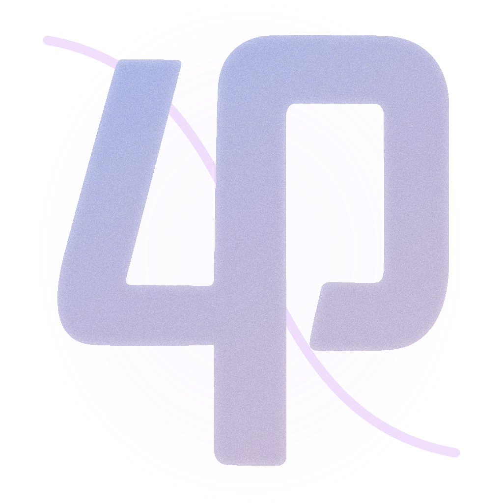
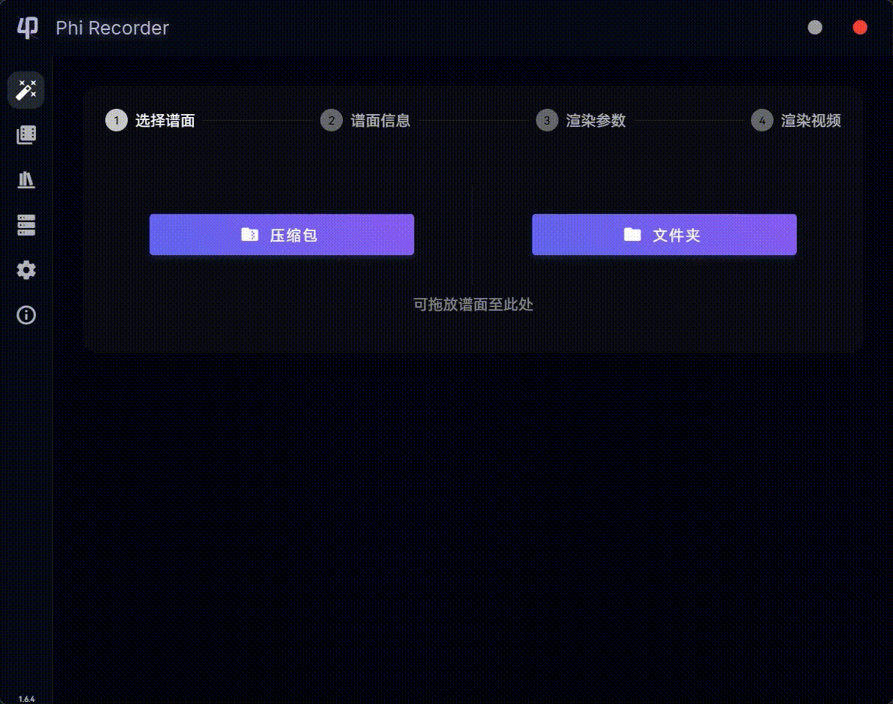

<div align="center">



# Phi Recorder

### 优雅 & 高效

文档 / Documentation: [Docs](https://pr.xhsr.org.cn/)

forked from TeamFlos/phira-render

[](https://github.com/AntiLeave/Phi-Recorder/releases/latest)
[](https://github.com/AntiLeave/Phi-Recorder/actions/workflows/ci.yml)
[]
[]

<br />



</div>

---

## Download 下载

Check [Releases](https://github.com/AntiLeave/Phi-Recorder/releases)

## build 构建

```bash
pnpm install
pnpm tauri build
```

## 注意事项 / Notice

- 请不要伪造游玩成绩、官方内容等，以免造成不好的影响  
  Please do not falsify game results, official content, etc. to avoid causing adverse effects
- 游玩界面与本家有明显区分, 如 COMBO 处文本与 `COMBO` 有明显区分  
  The game interface is clearly distinguished from the main interface, such as the text at COMBO is clearly distinguished from `COMBO`
- 不建议向不使用 `Re: PhiEdit` 的玩家分享本软件
- Sharing this software with players who do not use `Re: PhiEdit` is not recommended
